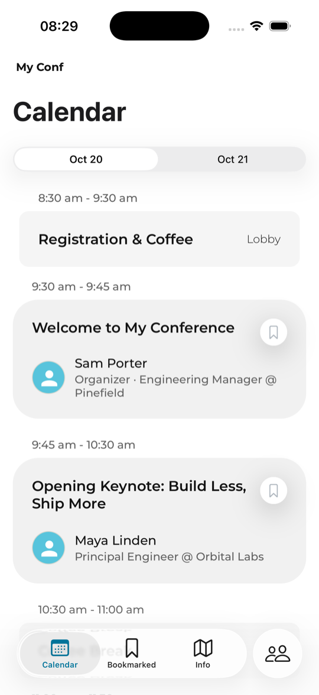
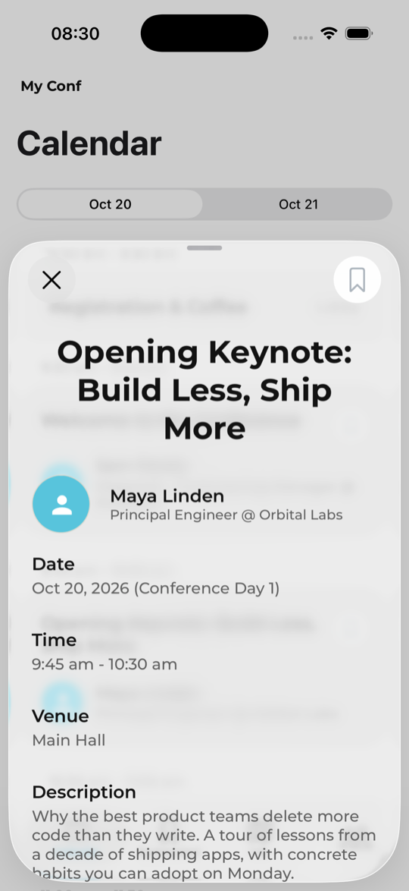
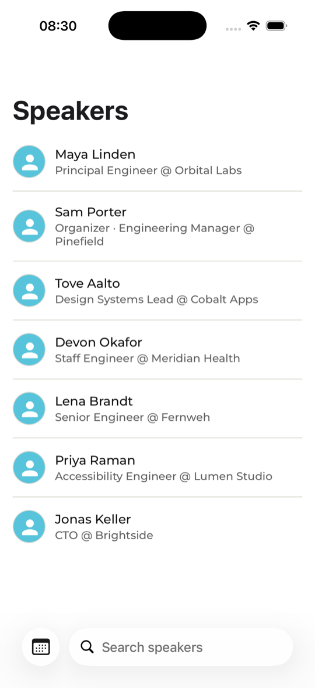
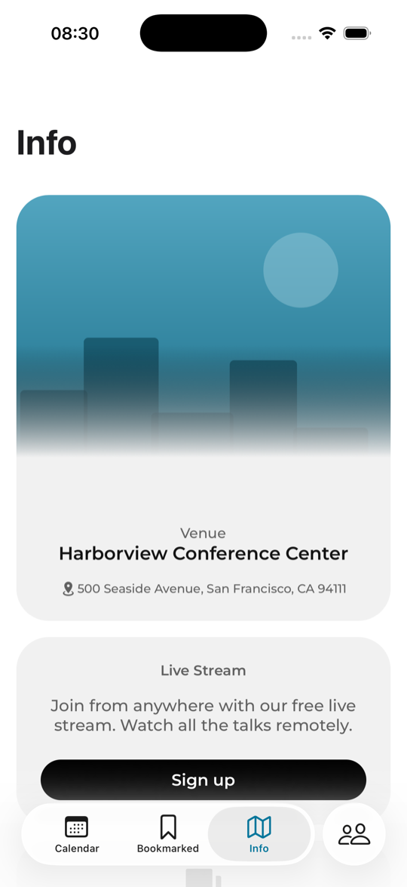
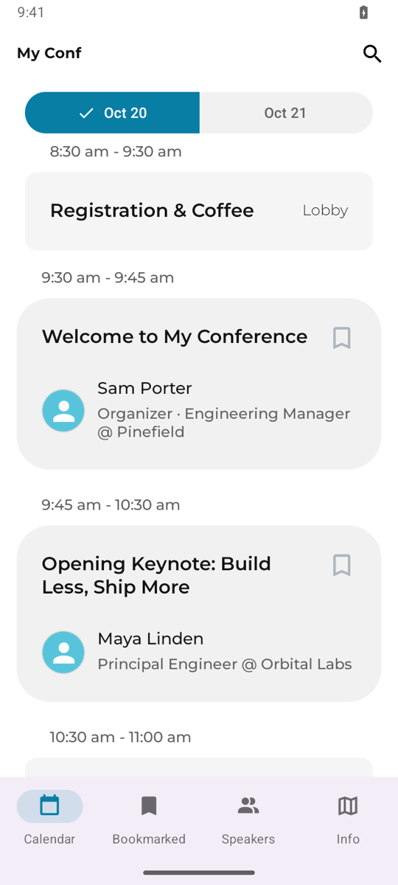
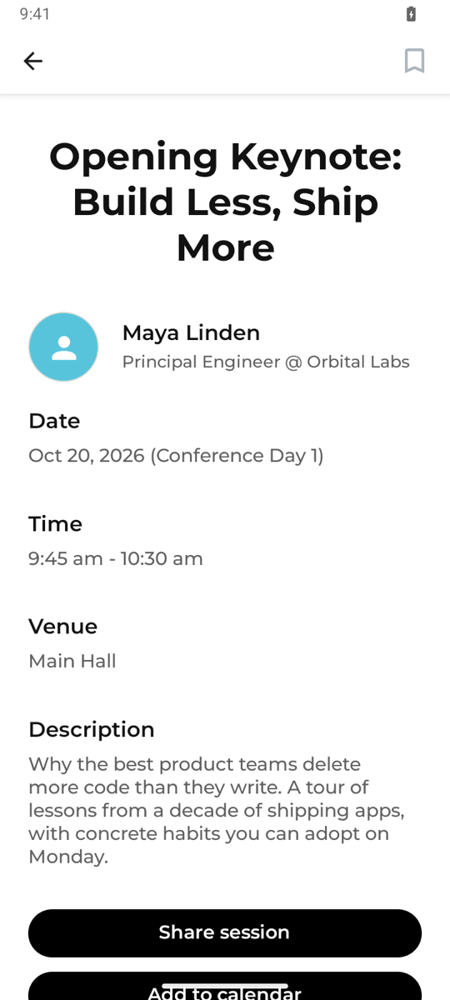
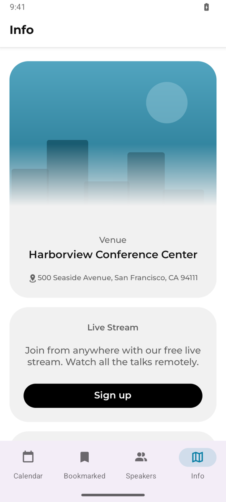
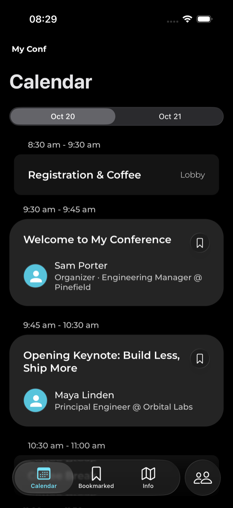

# Conference App Template

A whitelabel conference app built with [Expo](https://expo.dev). Edit one config file, replace one assets folder, and ship a native iOS and Android app for your event.

Based on the [React Conf 2025 app](https://expo.dev/blog/the-architecture-of-a-conference-application-built-with-expo).

## Screenshots

The template out of the box, with the bundled sample conference.

### iOS

| Schedule | Session | Speakers | Info |
| --- | --- | --- | --- |
|  |  |  |  |

### Android

| Schedule | Session | Info |
| --- | --- | --- |
|  |  |  |

### Dark mode

## Features

- Schedule grouped by day, derived from your data (any number of days)
- Session details with speakers, room, time, and description
- Speakers list with search and speaker details
- Bookmarks with optional local reminders before a session starts
- "Currently live" indicator in the schedule header
- All times display in the venue timezone
- Venue, sponsors, and custom info cards on the Info tab
- Offline first: a bundled data snapshot plus runtime refresh
- Light and dark mode

## Quick start

1. Click "Use this template" on GitHub and clone your copy.
2. Install dependencies: `bun install` (or `npm install`).
3. Run the app: `bun run ios` or `bun run android`. It starts with a fictional sample conference.
4. Edit `conference.config.ts` with your event name, colors, venue, and data source.
5. Replace the placeholder images in `assets/brand/` with your own.
6. If your data source is `sessionize` or `json`, pull your schedule into the offline snapshot: `bun run sync-data`.

## Configuration

`conference.config.ts` is the single source of truth. The app code reads it at runtime and `app.config.ts` reads it at build time. You do not need to edit any other file.

### Data sources

Set `data` in the config to one of:

- `{ source: "sessionize", sessionizeId: "..." }` — your [Sessionize](https://sessionize.com) API ID
- `{ source: "json", url: "https://..." }` — a JSON file in the normalized shape, see [docs/DATA.md](docs/DATA.md)
- `{ source: "bundled" }` — only the snapshot in `src/data/snapshot.json`, no runtime refresh

Run `bun run sync-data` before a release so the app has fresh data on first launch without a network connection.

### Brand assets

`assets/brand/` must contain:

| File | Size | Purpose |
| --- | --- | --- |
| `icon.png` | 1024×1024 | App icon |
| `adaptive-icon.png` | 1024×1024 | Android adaptive icon foreground |
| `adaptive-icon-monochrome.png` | 1024×1024 | Android monochrome icon |
| `splash-icon.png` | 512×512 | Splash screen image |
| `favicon.png` | 48×48 | Web favicon |
| `venue.png` | 1200×1200 | Venue photo on the Info tab |

`bun run generate-brand-assets` regenerates solid-color placeholders for any missing file.

### Builds and updates

Each conference needs its own EAS project:

1. Run `eas init` and `eas update:configure`.
2. Copy the project ID, update URL, and owner into the `eas` field in `conference.config.ts`.
3. Build with `eas build --profile production`.

## Development

- `bun run test` — unit tests
- `bun run lint` — ESLint
- `bun run typecheck` — TypeScript

## License

MIT
